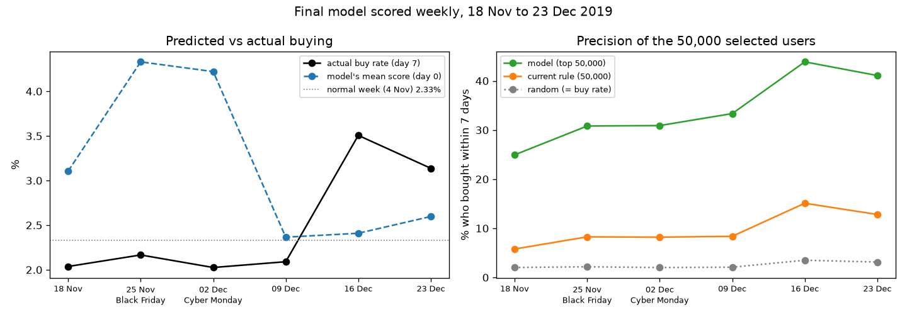
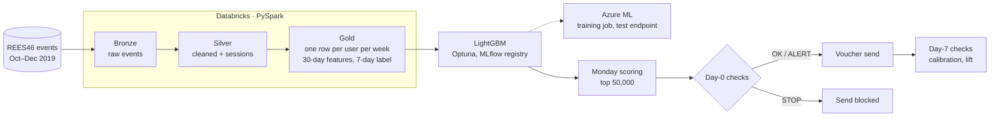

# E-commerce propensity targeting

A purchase-propensity model that decides who receives a fixed weekly voucher budget, built on real e-commerce event data, with the pipeline, experiment design and weekly monitoring needed to run it.

**Stack:** PySpark on Databricks · Airflow · LightGBM, XGBoost, CatBoost · Optuna · MLflow · Azure Machine Learning · Evidently

> Personal project. The retailer and stakeholder are fictional; the event data is real and public. Anything simulated is labelled as simulated.

## Problem

A retailer sends 50,000 discount vouchers a week to customers who added an item to their basket in the last seven days but did not buy. The aims were:

- select recipients more likely to buy, using the same budget;
- design a test that shows whether the vouchers cause extra purchases.

Full scope, label definition and leakage risks: [`docs/problem_statement.md`](docs/problem_statement.md).

## Results

**Targeting.** Test week 18 Nov 2019, 50,000 users selected by each method.

| Method | Share who bought within 7 days |
|---|---|
| Random (the week's buy rate) | 2.0% |
| Current rule: carted, not bought | 5.8% |
| Logistic regression | 21.7% |
| **LightGBM** | **24.8%** (95% CI 24.4–25.2%) |

LightGBM, XGBoost and CatBoost finished within 0.3 points of each other.

**Six weeks of weekly scoring (18 Nov to 23 Dec, including Black Friday and Christmas).** The final model (no cart features, see below) held a lift of 12–16 over random every week, with about 3–4 times the precision of the current rule. No retrain was triggered.



**Experimentation (Criteo uplift dataset, real).** The pre-registered analysis found that assignment to ad targeting raised conversion by 0.115 points (95% CI 0.108–0.122). A naive comparison of exposed users with the control group would have reported 5.18 points.

## Architecture



Airflow ([`airflow/dags/ecom_pipeline.py`](airflow/dags/ecom_pipeline.py)) runs the Databricks job and the weekly checks in order, with retries; a STOP on day 0 blocks the send, and the day-7 checks run either way.

## Approach

**Data pipeline.** About 3–4 million eligible users per weekly cut-off. The pipeline uses a bronze/silver/gold (medallion) layout on Delta tables. Sessions are rebuilt with a 30-minute inactivity rule. All features are computed strictly before each Monday cut-off, and the label is any purchase in the following seven days.

**Modelling.** Data is split by time: train on the 4 Nov cut-off, validate on 11 Nov, and test once on 18 Nov. Logistic regression is the baseline; the boosting models were tuned with Optuna on PR-AUC. The decision metric is precision in the top 50,000, with paired bootstrap confidence intervals. SHAP was used to explain individual scores and the model as a whole.

**Calibration.** Raw probabilities were about 2× too high on the test week. Platt scaling and base-rate anchoring correct the levels used for volume and profit estimates. Neither changes the ranking, so the same 50,000 users are selected.

**Experiment design.** The Criteo work covered:
- the pre-registered A/B analysis;
- the cost of peeking: 20 interim looks raise a 5% false-positive rate to 25% (simulated);
- a Bayesian Beta-Binomial analysis;
- uplift models compared against a plain response model.

The voucher test has a holdout inside each targeting group, runs for two weeks, and is judged on profit per 1,000 vouchers. Its design was checked on **simulated** data: A/A false-positive rate 4.5–5.8%, power 78–79% at the minimum detectable effect. Details: [`docs/experiments/voucher_test_design.md`](docs/experiments/voucher_test_design.md).

**Monitoring.** A weekly rule ([`monitoring/checks.py`](monitoring/checks.py)) sorts each check into three outcomes:

| Outcome | What triggers it | What happens |
|---|---|---|
| STOP | Broken data: row-count jumps, duplicates, emptied or constant features, invalid scores | The send is blocked |
| ALERT | Feature drift (PSI), score drift, or expected vs actual buyers out of range | The send goes ahead and a person reviews |
| Retrain | Lift in the top 50,000 falls more than 25% below recent weeks | The model is retrained |

Response steps are in [`docs/monitoring/runbook.md`](docs/monitoring/runbook.md).

## Key findings

- **A logging change, not a behaviour change.** In November, carts per purchase rose from 0.8 to 4.8. This pushed predicted volumes about 1.5× too high, while ranking precision stayed at 24.8–25.1% under every fix tested. The final model drops the cart features.
- **Event flags need evidence for each event.** A sale-week flag learned from Singles' Day doubled the predictions for Black Friday, when buying barely rose (2.17% vs about 2.0%).
- **Some changes are only visible on day 7.** Christmas demand (3.5% buy rate) passed every pre-send check and was caught only when outcomes arrived.

## Limitations

- One retailer, and one test week for model selection.
- The voucher effect is not measured: the REES46 data has no voucher data, so the voucher test is simulated.
- Because of the November cart-logging change, cart-based features are not reliable for this period.
- The Azure endpoint was deployed for testing and then deleted. It returned the same predictions as the local model.

## Repository

| Folder | Contents |
|---|---|
| `spark/` | Bronze/silver/gold pipeline (Databricks) and gold export |
| `airflow/` | DAG and Docker setup |
| `modelling/` | Baselines, boosting and tuning, SHAP, calibration |
| `experiments/` | Criteo A/B, peeking, Bayesian A/B, uplift, voucher test design |
| `monitoring/` | Drift reports, fix comparison, calibration in production, weekly checks |
| `azure/` | Azure ML training job and endpoint config |
| `app/` | Streamlit app that scores a user through the endpoint |
| `reports/` | Result tables and charts |

## How to run

```bash
uv sync                                        # Python 3.11
# 1. Run spark/01–04 as a Databricks job, then download the gold tables to data/gold/
uv run python modelling/02_boosting.py         # train, tune and test
uv run python experiments/01_criteo_ab.py      # needs the Criteo file in data/raw/criteo/
uv run python monitoring/05_weekly_checks.py replay
cd airflow && docker compose up                # orchestration (copy .env.example to .env)
```

## Data

- E-commerce behaviour data from a multi-category store, from [REES46 Marketing Platform](https://rees46.com) via [Kaggle](https://www.kaggle.com/datasets/mkechinov/ecommerce-behavior-data-from-multi-category-store). The data is not included in this repo.
- [Criteo Uplift Prediction Dataset](https://ailab.criteo.com/criteo-uplift-prediction-dataset/) (CC BY-NC-SA 4.0).

## Licence

Code: [MIT](LICENSE). The datasets keep their own licences (above) and are not included.
